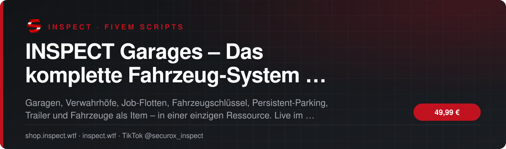
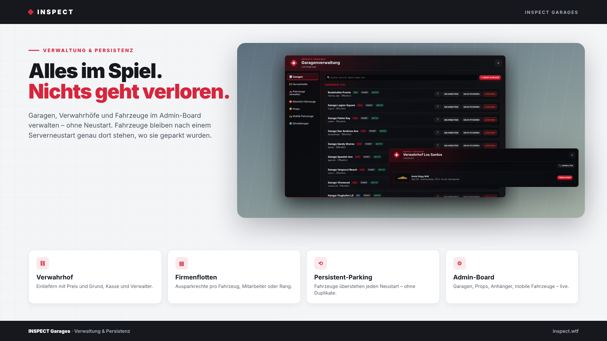
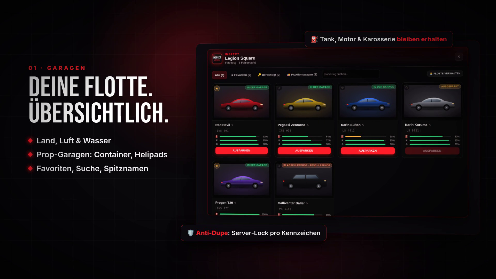
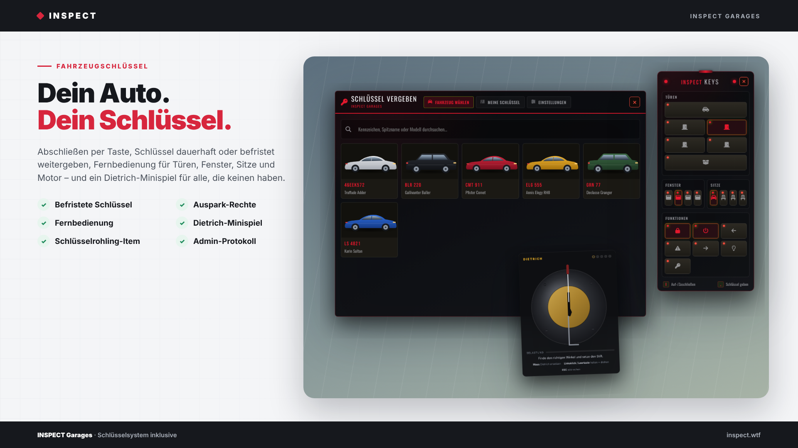
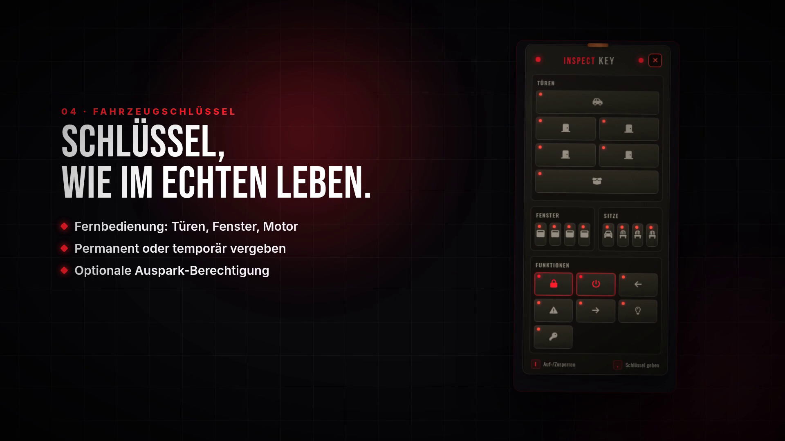
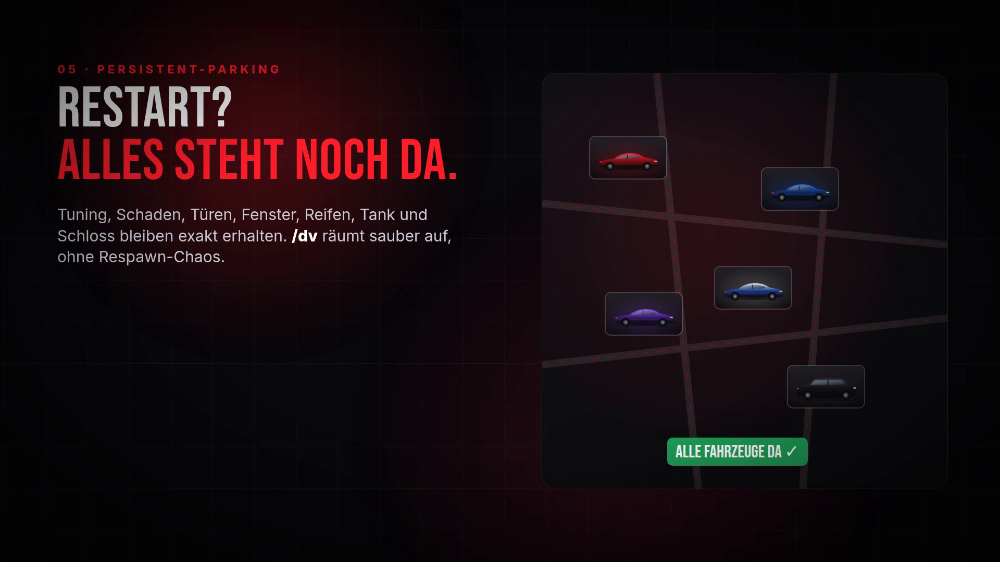
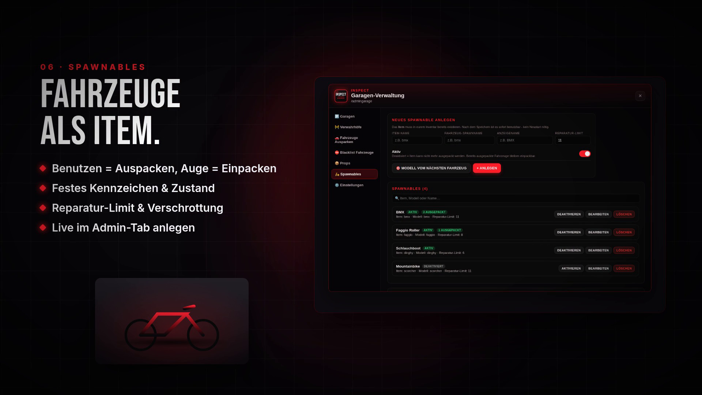

<!-- inspect-showcase: automatisch erzeugt, Änderungen bitte im Shop vornehmen -->

  
  
  
  
  

  
  
  

 

 

## Das Wichtigste auf einen Blick

<table>
  <tr>
    <td width="50%" valign="top">✔&nbsp; <b>Kompatibilität · ESX Legacy, QBCore und Qbox mit automatischer Framework-Erkennung</b></td>
    <td width="50%" valign="top">✔&nbsp; <b>Kompatibilität · Inventare: ox_inventory, qb-inventory, ps-inventory, lj-inventory, qs-inventory, jaksam_inventory, core_inventory, codem-inventory, tgiann-inventory, origen_inventory und ESX-Standard</b></td>
  </tr>
  <tr>
    <td width="50%" valign="top">✔&nbsp; <b>Kompatibilität · Fuel: ox_fuel, LegacyFuel, cdn-fuel, ps-fuel, lj-fuel, qs-fuelstations, okokGasStation, ti_fuel, Renewed-Fuel und hrs_fuel – automatisch erkannt, sonst GTA-Standardwert</b></td>
    <td width="50%" valign="top">✔&nbsp; <b>Kompatibilität · Datenbank: MariaDB 10.3+ und MySQL 8, Tabellen werden beim ersten Start automatisch angelegt</b></td>
  </tr>
</table>

## Überblick

Ein Fahrzeug-System statt sieben Einzel-Scripts.

Auf den meisten Servern laufen Garage, Verwahrhof, Schlüssel, Persistent-Parking und Trailer als getrennte Scripts. Das Ergebnis sind doppelte Fahrzeuge, Respawns nach /dv, verlorene Schäden und Konflikte zwischen den Ressourcen. INSPECT Garages bündelt alles in einer Ressource, in der jeder Teil vom anderen weiß.

Alles live im Spiel verwalten  
Über das Admin-Board /admingarage legt ihr Garagen, Verwahrhöfe, Prop-Garagen, Trailer-Modelle und Spawnables direkt im Spiel an, verschiebt sie per Ghost-Vorschau und schaltet sie an oder ab. Ein Neustart der Ressource ist dafür nie nötig.

Fahrzeuge bleiben, wie sie sind  
Tuning, Tank, Motor- und Karosserieschaden, Deformation, Türen, Fenster, Reifen und Schloss bleiben beim Ein- und Ausparken erhalten. Ausgeparkte Besitzfahrzeuge stehen auch nach einem Server-Restart genau dort, wo sie abgestellt wurden. /dv funktioniert sauber: kein Respawn, Besitzfahrzeuge gehen zurück in die Garage.

Gebaut gegen Duplikate  
Serverseitige Sperren pro Kennzeichen, atomare Datenbank-Updates, ein Watchdog bei Verbindungsabbrüchen und reservierte Spawnpunkte verhindern, dass Fahrzeuge doppelt entstehen – auch wenn mehrere Spieler gleichzeitig ausparken.

Für Jobs, Admins und Spieler  
Job-Garagen machen Fahrzeuge automatisch zu Firmenfahrzeugen, die der Chef pro Mitarbeiter oder Rang freigibt. Verwahrhöfe haben eine eigene Verwalter-Ansicht mit Preisen, Sperren und Geld-Lager. Das integrierte Schlüsselsystem bringt Fernbedienung, temporäre Schlüssel und ein Admin-Panel mit Protokoll mit. Trailer lassen sich beladen und überall per Auge einparken. Spawnables machen Fahrräder, Roller oder Boote zu Inventar-Items, inklusive Zustand, Reparatur-Limit und festem Kennzeichen.

Schnell installiert  
Framework, Inventar und Fuel-Script werden automatisch erkannt. Beim ersten Start legt das Script alle Tabellen selbst an (MariaDB und MySQL 8) und ergänzt eure bestehende Fahrzeugtabelle nur um eigene Spalten. Eure Bestandsfahrzeuge bleiben unverändert und stehen sofort in der Garage. Beispiel-Garagen, Verwahrhöfe, Item-Vorlagen und eine bebilderte Installationsanleitung (PDF) sind enthalten.

## Kompatibilität

| | |
|:--|:--|
| Frameworks | **ESX** · **QBCore** · **Qbox** |
| Unterstützte Ressourcen | `ox_inventory` · `ox_target` |
| Plattform | FiveM (GTA V) |

## Alle weiteren Funktionen

- Garagen · Punkt-Garagen und Prop-Garagen: Container, Helipads, Stege und passende Weltobjekte werden zur Garage
- Garagen · Getrennte Garagentypen für Land-, Luft- und Wasserfahrzeuge
- Garagen · Modernes, transparentes UI mit Fahrzeugbildern, Suche, Favoriten, Spitznamen sowie Tank-, Motor- und Karosserieanzeige
- Garagen · Gebühren fürs Ein- und Ausparken, Job-Beschränkung, Blip, Marker und Kartenkategorie pro Garage
- Garagen · Schaden und Deformation bleiben 1:1 erhalten (VehicleDeformation-Integration mit eingebautem Fallback)
- Anti-Dupe · Serverseitige Sperre pro Kennzeichen und atomare Datenbank-Updates bei jedem Ein- und Ausparken
- Anti-Dupe · Watchdog löst hängende Sperren nach Verbindungsabbrüchen
- Anti-Dupe · Spawnpunkt-Reservierung verhindert Kollisionen und Duplikate beim gleichzeitigen Ausparken
- Persistent-Parking · Ausgeparkte Besitzfahrzeuge bleiben über Restarts an ihrer letzten Position – mit Tuning, Schaden, Tank, Türen, Fenstern, Reifen und Schloss
- Persistent-Parking · /dv ohne Respawn: Besitzfahrzeuge gehen sauber zurück in die Garage

<b>32 weitere Funktionen anzeigen</b>

- Persistent-Parking · Alle Fahrzeuge inklusive Job-, Team- und NPC-Fahrzeugen in einer Tabelle – ideal als Datenquelle für Teamboards
- Persistent-Parking · Verlassene Job-, Team- und NPC-Fahrzeuge werden automatisch aufgeräumt
- Admin-Board · /admingarage: Garagen, Verwahrhöfe, Props, Trailer-Modelle, Spawnables und Einstellungen live verwalten – ohne Ressourcen-Neustart
- Admin-Board · Ghost-Vorschau zum exakten Platzieren von Garagen- und Prop-Punkten
- Admin-Board · Jedes Fahrzeug per Kennzeichen oder Besitzer finden und direkt neben sich ausparken
- Admin-Board · Restart-Blacklist für Modelle und Kennzeichen, z. B. für Job-Anhänger
- Verwahrhof · Einliefern per ox_target-Auge oder Befehl, mit individueller Auslösesumme und Grund
- Verwahrhof · Verwalter-Ansicht: Preise ändern, Fahrzeuge sperren, kostenlos zurückgeben, Geld-Lager abholen, Mitarbeiter freischalten
- Verwahrhof · Job-, Team- und NPC-Fahrzeuge werden beim Einliefern gelöscht statt fälschlich verwahrt
- Job-Flotten · Fahrzeuge in Job-Garagen werden automatisch Firmenfahrzeuge
- Job-Flotten · Freigabe pro Mitarbeiter oder pro Rang, Ernennung von Flottenmanagern
- Schlüssel · Auf- und Abschließen per Taste, Fernbedienung für Türen, Fenster, Sitze, Motor und Licht
- Schlüssel · Permanente oder zeitlich begrenzte Schlüssel vergeben, optional mit Auspark-Recht
- Schlüssel · Admin-Panel /admincarkey mit Übersicht, Vergabe, Park-Sperre, Fahrzeugöffnung und Protokoll
- Trailer · Fahrzeuge auf Trailern befestigen und lösen, mit automatischer Höhenanpassung
- Trailer · Eigene Trailer überall per Auge einparken – sie landen in ihrer Heimat-Garage
- Spawnables · Fahrzeuge als Inventar-Item: mit Animation auspacken, per Auge wieder einpacken
- Spawnables · Festes Kennzeichen pro Charakter und Item, Schaden, Tank und Tuning bleiben erhalten
- Spawnables · Reparatur-Limit mit Verschrottung, Notfall-Repkit und Mechaniker-Jobs konfigurierbar
- Spawnables · Live im Admin-Board anlegen, bearbeiten, deaktivieren, löschen und ausgepackte Fahrzeuge zurückholen
- Spawnables · Bei /dv erhält der Besitzer sein Item zurück – auch wenn er offline ist
- Spawnables · Optionales Discord-Webhook-Protokoll
- Installation · Bestehende Fahrzeugtabellen (owned_vehicles / player_vehicles) werden weiterverwendet und nur um eigene Spalten ergänzt
- Installation · Beispiel-Garagen, Verwahrhöfe für Land, Luft und Wasser sowie Trailer-Modelle vorkonfiguriert
- Installation · Item-Vorlagen für ox_inventory, QBCore, qs-inventory und ESX sowie manuelle SQL-Dateien enthalten
- Installation · Bebilderte Installationsanleitung als PDF mit Fehlerbehebung
- Entwickler · Exports für Verwahrhof, Fahrzeugrückgabe, Positionsabfrage, Persistenz und Schlüsselprüfung
- Entwickler · Config, Bridges, SQL und Item-Vorlagen offen editierbar
- Rechte · ACE-Recht inspect.garageadmin, zusätzliche Framework-Gruppen konfigurierbar
- Anpassung · Eigenes Logo, Farben, Servername und Fahrzeugbilder (png/jpg/webp)
- Voraussetzungen · OneSync, oxmysql, ox_lib und ox_target
- Sprache · Benutzeroberfläche auf Deutsch

## Einblicke

<table>
  <tr>
    <td width="50%"></td>
    <td width="50%"></td>
  </tr>
  <tr>
    <td width="50%"></td>
    <td width="50%"></td>
  </tr>
  <tr>
    <td width="50%"></td>
    <td width="50%"></td>
  </tr>
</table>

## Preis

**49,99 €** &nbsp;–&nbsp; einmaliger Kaufpreis · Download und Lizenz im Kundenkonto

Sichere Zahlung mit PayPal oder Kreditkarte · Rechnung als PDF · Support auf Deutsch

## So einfach geht's

1. **Im Shop kaufen** – sicher bezahlen mit PayPal oder Kreditkarte.
2. **Sofort loslegen** – Download und Lizenz stehen direkt nach Zahlungseingang in deinem Kundenkonto bereit, die Rechnung erhältst du als PDF.
3. **Einrichten** – bei Fragen hilft dir unser Support im Discord weiter.

## Warum INSPECT?

<table>
  <tr>
    <td width="50%" valign="top"><b>🇩🇪 Entwickelt in Deutschland</b> Konzeption, Entwicklung und Support aus einer Hand.</td>
    <td width="50%" valign="top"><b>💬 Persönlicher Support</b> Schnelle Hilfe auf Deutsch im INSPECT Discord.</td>
  </tr>
  <tr>
    <td width="50%" valign="top"><b>🔒 Sichere Zahlung</b> PayPal oder Kreditkarte, Rechnung automatisch als PDF.</td>
    <td width="50%" valign="top"><b>⚡ Sofort verfügbar</b> Download und Lizenz direkt nach der Zahlung im Kundenkonto.</td>
  </tr>
</table>

## Häufige Fragen

<b>Wie erhalte ich das Produkt?</b>

 

Nach bestätigter Zahlung stehen Download und Lizenz in deinem Kundenkonto bereit. Die Rechnung erhältst du als PDF.

<b>Welche Frameworks werden unterstützt?</b>

 

ESX, QBCore, Qbox – zusätzlich mit Unterstützung für ox_inventory, ox_target.

<b>Bekomme ich Hilfe bei der Einrichtung?</b>

 

Ja – unser Support hilft dir im [INSPECT Discord](https://discord.gg/inspect) persönlich und auf Deutsch.

<b>Wo kaufe ich offiziell?</b>

 

Ausschließlich im INSPECT Shop unter [shop.inspect.wtf](https://shop.inspect.wtf). Angebote von Dritten stammen nicht von uns.

## Kontakt

| | |
|:--|:--|
| 🛒 Shop | [shop.inspect.wtf](https://shop.inspect.wtf) |
| 🌐 Website | [inspect.wtf](https://inspect.wtf) |
| 💬 Discord | [discord.gg/inspect](https://discord.gg/inspect) |
| 🎬 TikTok | [@securox_inspect](https://www.tiktok.com/@securox_inspect) |
| ✉️ E-Mail | [info@inspect.wtf](mailto:info@inspect.wtf) |

---

<b>SecuroX Inspect</b> · Offizielle Produktpräsentation · Dieses Repository enthält keinen Quellcode und keine Produktdateien. 
Kauf und Lizenzen ausschließlich über <a href="https://shop.inspect.wtf">shop.inspect.wtf</a> · Inhalte werden automatisch aus dem Shop aktualisiert.

